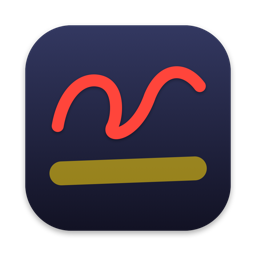
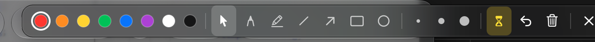
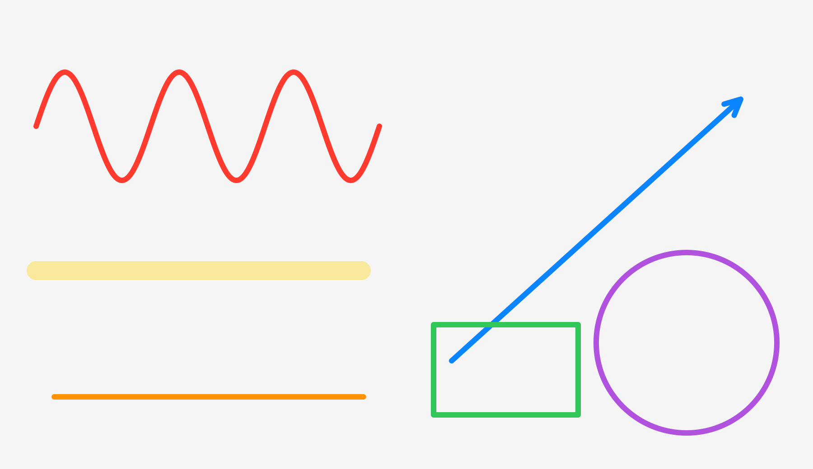

<p align="center">
  
</p>

<h1 align="center">Scrawl</h1>

<p align="center">
  <b>A tiny, fast screen annotation tool for macOS.</b><br>
  Draw on top of anything (slides, PDFs, videos, code, a video call) with your mouse or trackpad, then let the ink fade away on its own.
</p>

<p align="center">
  
  
  
  
  
</p>

<p align="center">
  
</p>

---

## Why

You're studying from slides, explaining something on a call, or recording a tutorial, and you want to circle that one thing or underline a line for a second. Scrawl puts a transparent layer over your screen when you press a shortcut. You scribble, and the ink disappears by itself a moment after you stop. Press the shortcut again and you're back to clicking things normally.

## Features

- **Mouse mode, one click away.** The cursor button on the toolbar (or `M`) lets clicks go through to your apps while your drawings and the toolbar stay on screen. Click a pen, color or size to draw again.
- **Temporary ink (auto-fade).** Strokes fade out together shortly after your *last* stroke, so you can write a whole word before it vanishes. Press `F` to switch to persistent ink.
- **6 tools:** pen, highlighter, line, arrow, rectangle and ellipse. Hold `Shift` for 45° lines, squares and circles.
- **8 colors** and adjustable stroke size (`[` `]` or scroll).
- **Undo / redo** across all displays.
- **Whiteboard / blackboard** mode (`W` / `B`) for a blank page to sketch on.
- **Works everywhere:** all Spaces, full-screen apps, Keynote / PowerPoint / PDF presentations, and every connected display.
- **Global hotkey** that needs no Accessibility or Input Monitoring permission.
- **Menu bar only**, with no Dock icon and no windows in your way.
- **URL scheme** for Shortcuts, Raycast, Alfred and Stream Deck: `scrawl://toggle`, `scrawl://start`, `scrawl://stop`, `scrawl://mouse`, `scrawl://clear`, `scrawl://undo`.
- **Launch at login** (macOS 13+).

<p align="center">
  
</p>

## Built to be light

Scrawl is native Swift + AppKit with no Electron, no web views and no dependencies. Measured on a MacBook Air M1:

| | |
|---|---|
| App size | **< 1 MB** (universal binary) |
| CPU while idle | **0.0 %**, with 0 idle wake-ups |
| Memory | **~18 MB** |

How it gets there:

- **Nothing runs while idle.** Hotkeys use Carbon's `RegisterEventHotKey`, so there's no event tap, no polling and no timers. When there's no ink on screen, the overlay windows are removed from the window server entirely.
- **GPU-composited strokes.** Every stroke is a `CAShapeLayer` in a layer-hosting view, with no `drawRect` and no full-screen bitmap redraws. Fading is a Core Animation opacity animation run by the render server, so it costs ~0% CPU in the app.
- **O(1) work per mouse event.** Freehand strokes use incremental midpoint quadratic smoothing, so each event only appends one segment. Long strokes are split into chunks so a path never grows big enough to slow down updates.
- **Retina-correct** layers (`contentsScale` matches each display), and implicit animations are disabled for instant feedback.

## Install

### Download

1. Grab **Scrawl.zip** from the [latest release](../../releases/latest) and unzip it.
2. Move **Scrawl.app** to `/Applications`.
3. The app is ad-hoc signed (not notarized), so the first time, **right-click → Open → Open**. Or run:
   ```bash
   xattr -dr com.apple.quarantine /Applications/Scrawl.app
   ```

### Build from source

You need the Xcode Command Line Tools (`xcode-select --install`).

```bash
git clone https://github.com/IbrahimTalha0/scrawl.git
cd scrawl
./build.sh install      # builds a universal app, copies it to /Applications and launches it
```

Other options: `./build.sh` (build only, output in `build/Scrawl.app`), `./build.sh zip` (release zip), and `ARCHS=arm64 ./build.sh` (Apple Silicon only, faster).

## Usage

Press **`⌃⇧D`** (Control-Shift-D) to start drawing, draw, then press **`Esc`** or `⌃⇧D` again to stop.
The global shortcut can be changed from the menu bar icon (`⌃⇧D`, `⌥⇧D`, `⌃⌥⌘D` or `⌃⇧A`).

### Shortcuts

| Global | |
|---|---|
| `⌃⇧D` | Start / stop drawing (from mouse mode: back to drawing) |
| `⌃⇧C` | Clear all drawings (works even when not drawing) |

| While drawing | |
|---|---|
| `M` | Mouse mode: click through, ink and toolbar stay |
| `P` `H` `L` `A` `R` `O` | Pen, Highlighter, Line, Arrow, Rectangle, Ellipse |
| `1` – `8` | Red, Orange, Yellow, Green, Blue, Purple, White, Black |
| `[` / `]` or scroll | Thinner / thicker |
| `Shift` + drag | Snap lines to 45°, perfect squares and circles |
| `F` | Toggle auto-fade (temporary vs. persistent ink) |
| `⌘Z` / `⇧⌘Z` | Undo / Redo |
| `C` or `Delete` | Clear all |
| `W` / `B` | Whiteboard / Blackboard background |
| `T` | Show / hide the toolbar |
| `Esc` | Stop drawing (cancels the current stroke first) |

Need to click something mid-explanation? Hit the **cursor button** on the toolbar (or `M`). The canvas steps aside, so you can click, scroll and type in any app while your annotations stay visible. Click any pen, color or size on the toolbar (or press `⌃⇧D`) to keep drawing. The toolbar's ✕ closes everything.

When you stop drawing, persistent ink **stays on screen** and you can click through it normally. Clear it with `⌃⇧C`, or turn on *Clear When Drawing Stops* in the menu.

### Menu bar options

- Tool and color
- Auto-fade on/off and the fade delay (0.75 s – 5 s)
- Show the toolbar while drawing
- Clear when drawing stops
- Global shortcut preset
- Launch at login

## Project layout

```
Sources/
  main.swift               app entry point (menu-bar-only app)
  AppDelegate.swift        status item, menu, hotkeys, URL scheme
  OverlayController.swift  overlay windows per display, draw mode, fade, undo, keys
  CanvasView.swift         layer-hosting canvas, strokes, shapes, cursor
  Toolbar.swift            floating toolbar + toast HUD
  HotKeys.swift            Carbon global hotkeys
  Settings.swift           preferences, tools, palette
Resources/                 Info.plist, AppIcon.icns
scripts/make-icon.swift    regenerates the app icon
build.sh                   swiftc build script (no Xcode project needed)
```

## License

[MIT](LICENSE) © 2026 Talha Demir
